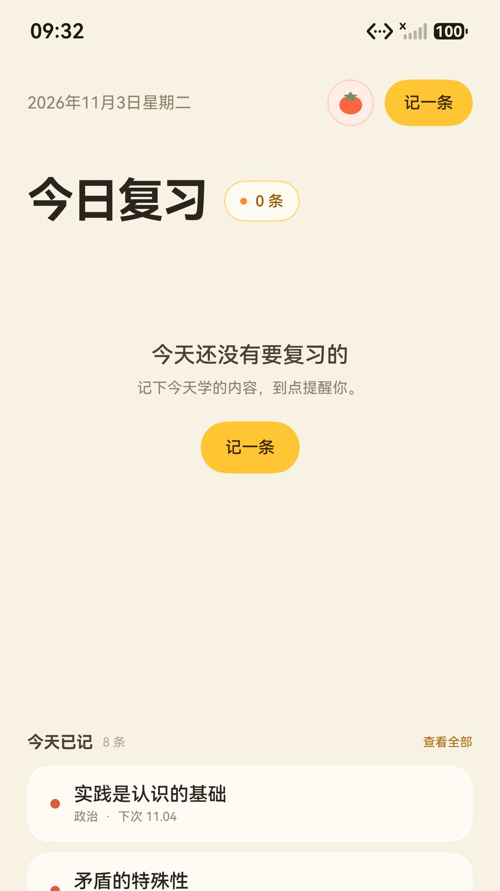
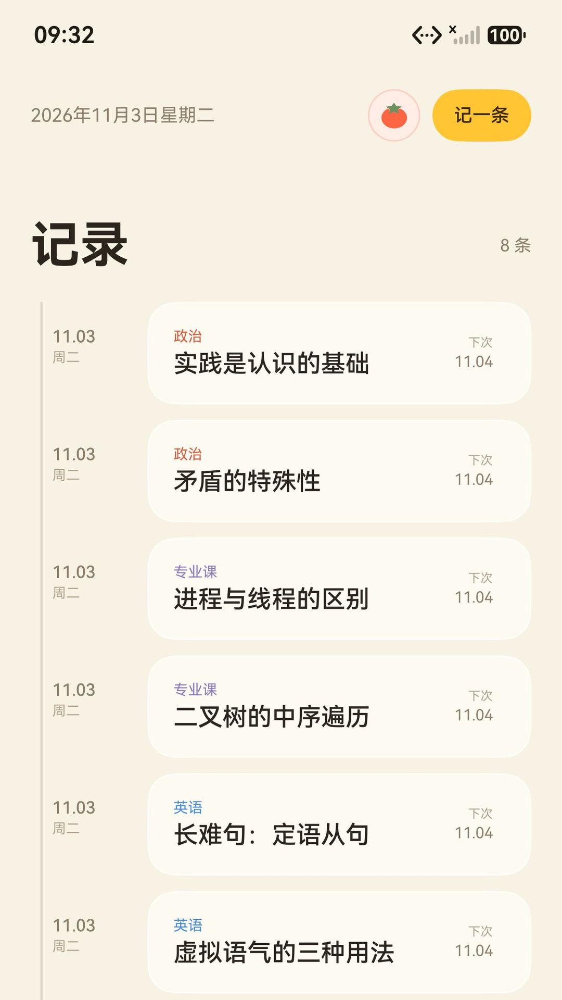
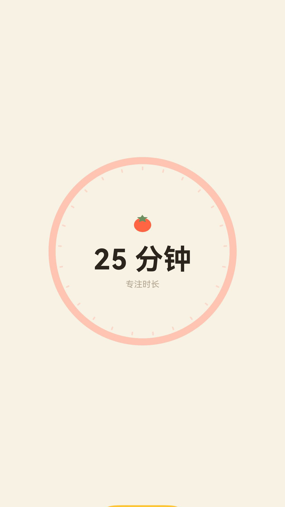

# Folio · 结绳

A local-first spaced-repetition reminder for Android. No account, no cloud, no AI —
everything stays on the device.

一个只做三件事的本地复习提醒 App：

1. 记下今天学了什么。
2. 默认用 FSRS-6 记忆算法排期，也可以切到固定间隔；到点用系统提醒叫你。
3. 复习后按「忘记 / 困难 / 良好 / 简单」评分，自动排下一次。

  

> 这个仓库原本是鸿蒙版（ArkTS），已整体移植到 Android（Kotlin + Jetpack Compose）。
> 界面、配色、动效和交互都沿用原版，见下方「动效」一节。

## 功能

- 今日复习队列、快速记录（自建科目 + 章节 / 知识点）
- 默认 FSRS-6 动态排期，可切固定间隔并直接输入天数
- 记忆保持率 80%–95% 可调（默认 90%），评分前能看到四档对应的下次间隔
- 番茄钟：全屏圆盘、连续循环（专注 25 分钟 / 休息 5 分钟，每 4 轮休息 15 分钟）、按分钟刻度递减、专注结束响一声
- 记录时间轴、接下来 7 / 14 / 30 天日历、四套页面配色
- 单条记录管理：点击看详情，长按改标题 / 科目或删除；没有「清空全部」
- 手机单列 / 平板横屏左右分栏（`isWide = 宽度 ≥ 840dp 且 宽度 > 高度 × 1.05`）
- 界面语言：中文 / English / 日本語 / 한국어 / Français / Español

## 下载

到 [Releases](https://github.com/ZuBeri05/Folio/releases) 下载，两个版本各一份：

| 文件 | 平台 |
|---|---|
| `folio-<版本>-release.apk` | 手机 / 平板 |
| `folio-wear-<版本>-release.apk` | Wear OS 手表 |

Release 包用仓库里的 `app/keystore/folio-release.jks` 签名，和 CI 打出来的包一致，
所以后续版本可以直接覆盖安装。Debug 包也在 Release 里附了一份，方便对照。

## 手表版（Wear OS）

手表版和手机版在同一个模块里，用 product flavor 区分：

- **逻辑层与动效编排只有一份**：`domain/`、`data/`、`services/` 和 `ui/FolioState.kt`
  都在 `src/main`，两个版本共用。手表版拿到的还是同一个 `FolioState`，
  入场接力、条数弹跳、页面切换、番茄钟刻度淡出、浮层进出用的都是同一套 `Motion`
  曲线和时序 —— 动画不是"照着做一遍"，是同一份代码。
- **界面层各写一份**：`src/phone`（原版四页 + 浮层）与 `src/wear`（按圆屏重排）。

圆屏上的重排：

- 今日：一屏一条，标题居中、左右滑动换条目，底部是「复习」和番茄钟入口
- 记录：竖向列表，逐条从左侧牵出
- 设置：只留专注时长 / 保持率 / 配色三项，翻页切换
- 复习：条目文字居中，评分四档做成 2×2
- 番茄钟：同一个圆盘与刻度，尺寸按表盘收

最低要求 Wear OS 3（API 30）。

## 提醒

- 每日提醒用 `AlarmManager.setInexactRepeating`，到点数一遍今天要复习几条再弹通知
- 专注结束用 `setExactAndAllowWhileIdle` 一次性闹钟，到点响一声
- 开机 / 应用更新后由 `BootReceiver` 重新挂上
- 设置页显示提醒方式与已安排数量，权限被拒时显示原因

权限只有 `POST_NOTIFICATIONS`、`SCHEDULE_EXACT_ALARM`、`RECEIVE_BOOT_COMPLETED`。
拒绝通知权限不影响记录和复习，只是关掉 App 后没有系统提醒。

## 构建

需要 JDK 17 和 Android SDK 35：

```bash
./gradlew testPhoneDebugUnitTest   # 纯逻辑单元测试
./gradlew assemblePhoneRelease     # 手机正式包
./gradlew assembleWearRelease      # 手表正式包
```

四个包（手机 / 手表 × debug / release）也可以交给 CI：推到 `main` 后 GitHub Actions
自动跑测试并构建全部，产物在 workflow 的 artifact 里；
打 `v*` 标签会额外建一个 Release 并附上 APK。

## 测试

纯函数层（FSRS-6、排期、迁移、专注计时）有单元测试，不依赖设备：

| 测试文件 | 覆盖 |
|---|---|
| `FsrsTest` | 初始权重、四档预览顺序、`[2, 11, 46, 163, 497]` golden 序列 |
| `SchedulingTest` | 跨天取整、逾期奖励 1.5× 封顶、最长间隔截断、固定间隔模式 |
| `FocusTest` | 倒计时格式（400ms 显示 00:01）、小结统计、周桶、每 4 轮长休息 |
| `MigrationTest` | 旧数据迁移的各个分支与幂等性 |

## 工程结构

```text
app/src/main/java/com/jiesheng/folio/
  MainActivity.kt
  domain/            Models、Dates、fsrs/（FSRS-6、排期、迁移）、focus/
  data/              Store（SharedPreferences）、Codec（JSON）
  services/          I18n、I18nTables、ReminderService、Receivers
  theme/             Tokens（颜色 / 动效刻度）、Motion 曲线
  ui/                FolioState（状态与交互）、四个页面、全部浮层、Anim、Common
app/src/main/res/    图标（vector）、配色、文案
app/src/test/        单元测试
```

## 动效

动效统一由 `theme/Tokens.kt` 里的 `Motion` 驱动，页面里不出现手填的时长和曲线。

| 时长 | 值 | 用途 |
|---|---|---|
| `instant` | 110ms | 按下、勾选这类微反馈 |
| `quick` | 170ms | 图标、小控件状态切换 |
| `base` | 260ms | 卡片、面板 |
| `slow` | 380ms | 整块入场 |
| `page` | 520ms | 页面切换 |

| 曲线 | 值 | 用途 |
|---|---|---|
| `decel` | cubic-bezier(0.05, 0.7, 0.1, 1) | 入场，快起慢停 |
| `accel` | cubic-bezier(0.3, 0, 1, 1) | 退场，慢起快走 |
| `standard` | cubic-bezier(0.2, 0, 0, 1) | 同屏过渡 |
| `settle` | spring(dampingRatio 1.0, stiffness 180) | 列表、面板落位，几乎不过冲 |
| `snap` | spring(dampingRatio 0.86, stiffness 420) | 按钮、小元素，脆快 |
| `bounce` | spring(dampingRatio 0.54, stiffness 340) | 撞击回弹 |
| `follow` | spring(dampingRatio 0.85, stiffness 300) | 拖拽跟手 |

弹簧是物理曲线，不配 duration。位移幅度走 `Motion.travel(base, 屏宽)` 按屏宽缩放，
时长跟着幅度小幅收敛（0.86–1.14 倍），手机和平板节奏一致。

四个页面各一套入场机制，避免同一个回弹动作反复出现：今日是标题左 / 列表下 / 已记右的
三段接力，记录是时间轴逐段生长、卡片被牵出，日历是单行从右撞入、逐行错峰，
设置是 5 张卡轮流左 / 下 / 右。记录和日历的总时长对齐，切页不会一快一慢。

## 数据

所有数据存在本机 SharedPreferences（`jiesheng_app` / `app_data_v1`），不上传、不联网。
卸载 App 即全部删除。详见 [隐私政策](docs/privacy-policy.md)。

JSON 结构与移植前的鸿蒙版完全一致，两边的数据可以直接互换。

## 许可

[MIT](LICENSE)
